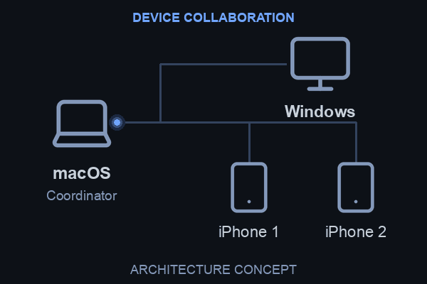

<h1 align="center">Hi 👋, I'm Zhechen Tu</h1>
<h3 align="center">Jelly · Computer Science @ UW–Madison</h3>

  

  
  
  

### About me

I build AI systems that connect research with real-world use — from **clinical RAG and agent engineering** to **distributed inference and full-stack applications**.

- 🎓 **CS @ UW–Madison**, Class of 2027.
- 🔬 Leading technical development of a **thyroid cancer AI support system at UW–Madison Surgery**, focused on traceable generation and safety evaluation.
- ☁️ Previously built and evaluated **tool-calling and multi-agent systems at Microsoft Cloud & AI**.
- 🛠️ Currently exploring how everyday devices can work together to run larger models.

### 🔭 Currently building: HeteroMesh

[**HeteroMesh — heterogeneous distributed inference**](https://github.com/tuzhechen2005/heteromesh)

Connecting **Windows, macOS, and iPhone** to pool scattered memory and compute, with fully local video generation as the first target.

**Python · PyTorch · Swift · cross-platform systems**

> **In development:** foundational communication and real small-model relay are implemented; H3 partitioning passes small-configuration tests. The full video pipeline, H3 generation, and iPhone hardware inference are still to be validated.

[Repository ↗](https://github.com/tuzhechen2005/heteromesh) · [System design ↗](https://github.com/tuzhechen2005/heteromesh/blob/main/docs/spec/system-spec.md)

### 🚀 Selected projects

| Project | What I'm building | Stack |
| :--- | :--- | :--- |
| [**Buzzer**](https://github.com/tuzhechen2005/CS639-Project2-Buzzer) | A classroom party quiz platform with a shared host screen, mobile players, and live scoring. Team project. | FastAPI · Socket.IO · React · MySQL · Redis |
| [**Local Azure ReAct Agent**](https://github.com/tuzhechen2005/semantic-kernel-azure-react-agent) | A local documentation agent with allowlisted tools, bounded recovery, source citations, and auditable traces. | Semantic Kernel · Phi-3 · Python |
| [**Financial Asset QA**](https://github.com/tuzhechen2005/financial-asset-qa) | Financial Q&amp;A that routes questions to live market data or document retrieval, with sources and evaluation dashboards. | Next.js · FastAPI · FAISS · Tavily |
| [**Terruto**](https://github.com/tuzhechen2005/terraria-naruto-mod) | A Naruto Part I adventure mod with story progression, boss encounters, chakra mechanics, and pixel art. | C# · tModLoader |

[More research and project stories on my website ↗](https://me.jellythebest.com/projects.html)

### 🧰 Languages & tools

  

**Also working with:** LangGraph · Semantic Kernel · AutoGen · Milvus · BM25 · Kafka.

### 📊 GitHub activity

  
  

### 🎸 Beyond the terminal

Guitar, cooking, baking, and basketball. I like building things people can use — and occasionally worlds they can get lost in.

**Let's talk** about AI applications, agent systems, research, or an interesting idea worth building.

[Website](https://me.jellythebest.com) · [LinkedIn](https://www.linkedin.com/in/jellythebest/) · [Email](mailto:ztu29@wisc.edu)
