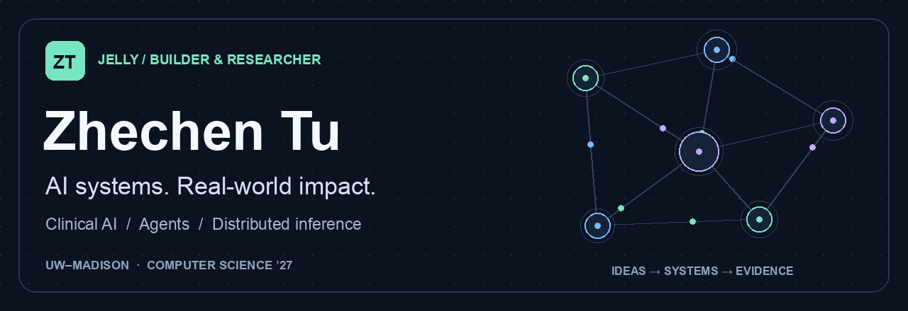
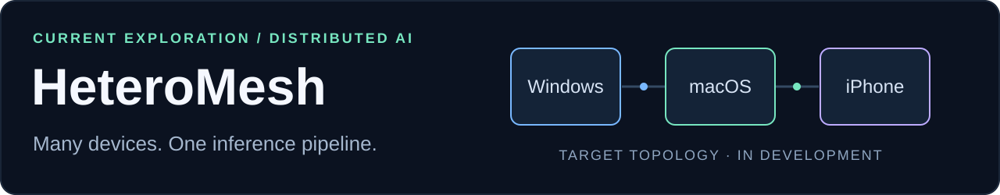
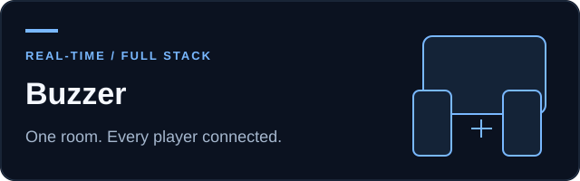
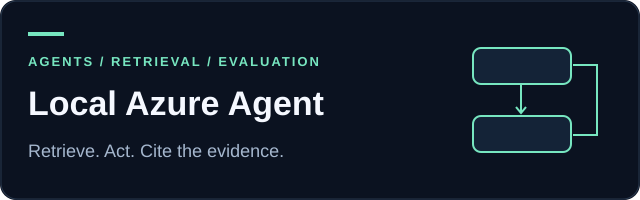
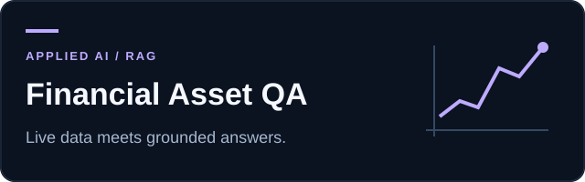
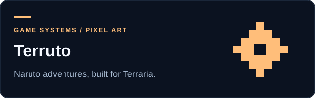

  

  
  
  

### Hey, I'm Zhechen — you can call me Jelly.

I'm a **Computer Science student at UW–Madison** building AI systems that connect research with real-world use. My interests span **clinical AI, grounded retrieval, agent engineering, and distributed inference**.

Currently, I lead the technical development of a thyroid cancer AI support system with **UW–Madison Surgery**, working on clinical RAG, traceable generation, and safety evaluation. Previously, I built and evaluated tool-calling and multi-agent systems at **Microsoft Cloud & AI**.

## On my desk → HeteroMesh

**What if the devices you already own could work together to run a larger model?**

[**HeteroMesh**](https://github.com/tuzhechen2005/heteromesh) explores heterogeneous distributed inference across **Windows, macOS, and iPhone**, pooling scattered memory and compute. The first target is fully local video generation.

- **Built so far:** foundational communication, real small-model relay, and H3 Transformer partitioning with small-configuration tests.
- **Next:** complete the video pipeline and validate it across physical devices. Full H3 generation and iPhone hardware inference are still unverified.
- **Working with:** Python · PyTorch · Swift · cross-platform inference.

[Explore the repository ↗](https://github.com/tuzhechen2005/heteromesh) · [Read the system design ↗](https://github.com/tuzhechen2005/heteromesh/blob/main/docs/spec/system-spec.md)

## Selected builds

<table>
<tr>
<td width="50%" valign="top">

A classroom party quiz platform: a shared host screen, mobile players, live answers, and scoring. Built as a team project.

<b>FastAPI · Socket.IO · React · MySQL · Redis</b>

<a href="https://github.com/tuzhechen2005/CS639-Project2-Buzzer">View project ↗</a>
</td>
<td width="50%" valign="top">

A local ReAct agent for Azure documentation, with allowlisted tools, bounded recovery, source citations, and auditable traces.

<b>Semantic Kernel · Phi-3 · Python · local inference</b>

<a href="https://github.com/tuzhechen2005/semantic-kernel-azure-react-agent">View project ↗</a>
</td>
</tr>
<tr>
<td width="50%" valign="top">

A financial Q&amp;A app that routes questions to live market data or a document retrieval pipeline, with sources and evaluation dashboards.

<b>Next.js · FastAPI · FAISS · Tavily · yfinance</b>

<a href="https://github.com/tuzhechen2005/financial-asset-qa">View project ↗</a>
</td>
<td width="50%" valign="top">

A Naruto Part I adventure mod: story progression, boss encounters, chakra mechanics, and pixel art. Currently refining the Chunin Exams arc.

<b>C# · tModLoader · game systems · pixel art</b>

<a href="https://github.com/tuzhechen2005/terraria-naruto-mod">View project ↗</a>
</td>
</tr>
</table>

[More research and project stories on my website ↗](https://me.jellythebest.com/projects.html)

## My toolkit

| Area | Technologies I work with |
| :--- | :--- |
| **AI & agents** | PyTorch · LangGraph · Semantic Kernel · AutoGen · RAG |
| **Retrieval & data** | Milvus · FAISS · BM25 · MySQL · Redis |
| **Backend & systems** | Python · FastAPI · Java · Docker · Kafka |
| **Interfaces & creative work** | React · Next.js · TypeScript · C# · tModLoader |

## Beyond the terminal

Guitar, cooking, baking, and basketball. I like building things that people can actually use — and occasionally worlds they can get lost in.

**Let's talk** about AI applications, agent systems, research, or an interesting idea worth building.

[Website](https://me.jellythebest.com) · [LinkedIn](https://www.linkedin.com/in/jellythebest/) · [Email](mailto:ztu29@wisc.edu) · [All repositories](https://github.com/tuzhechen2005?tab=repositories)
